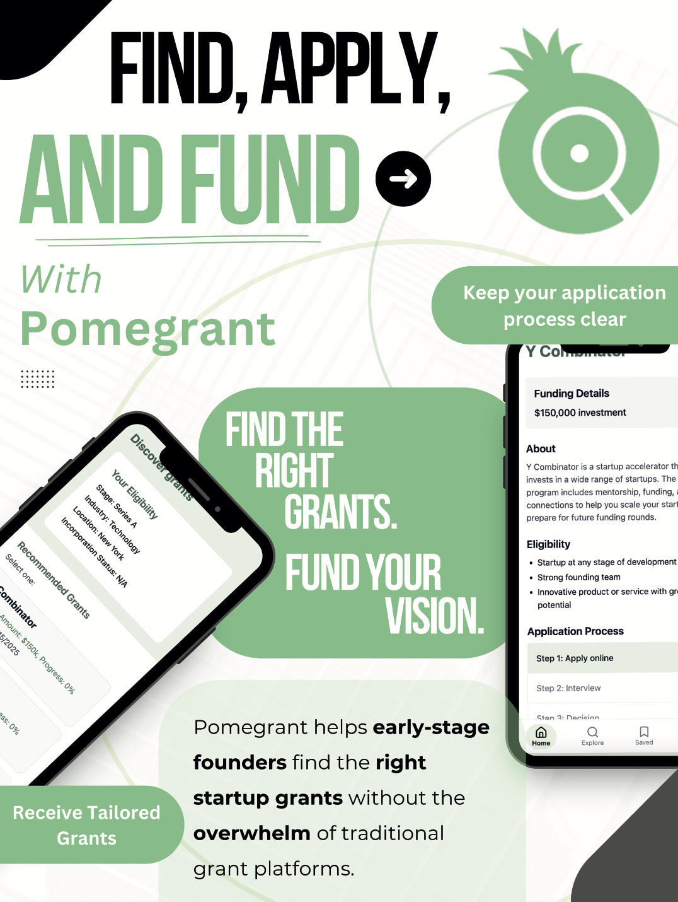
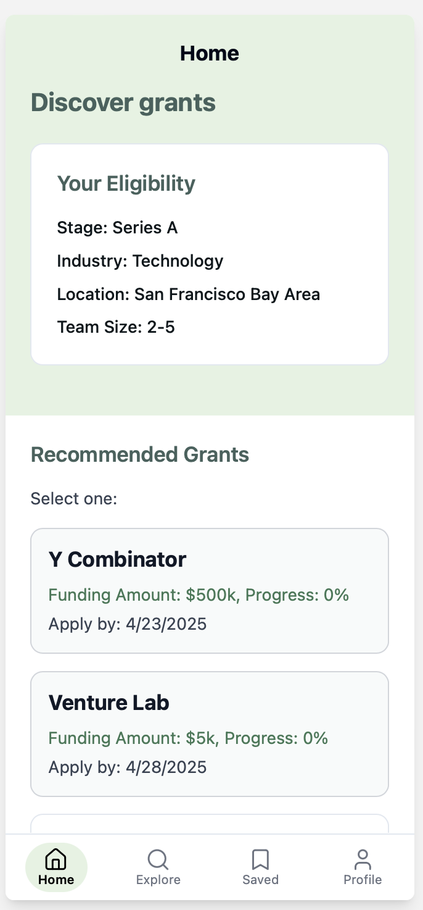
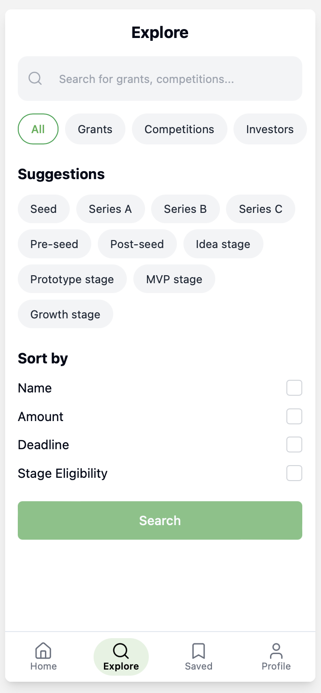
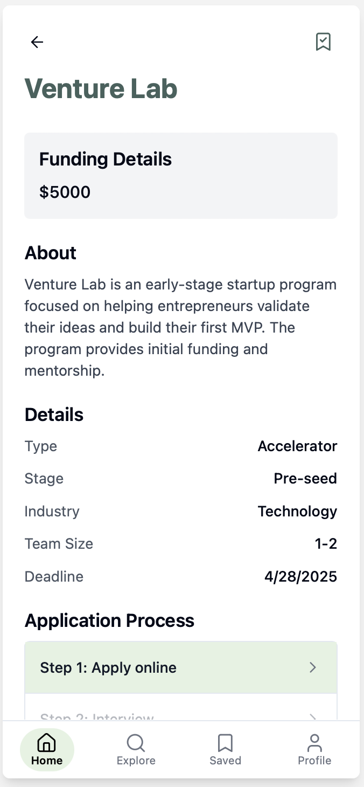
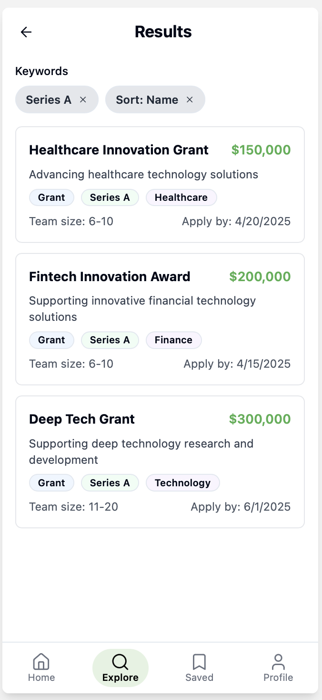
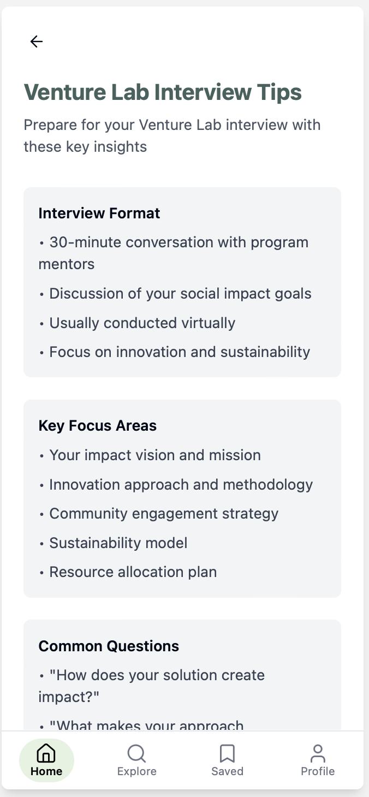
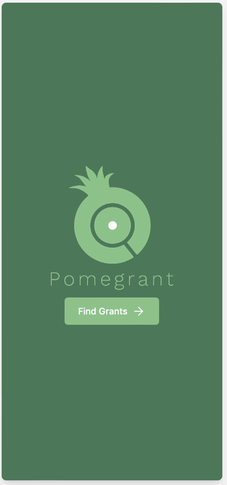
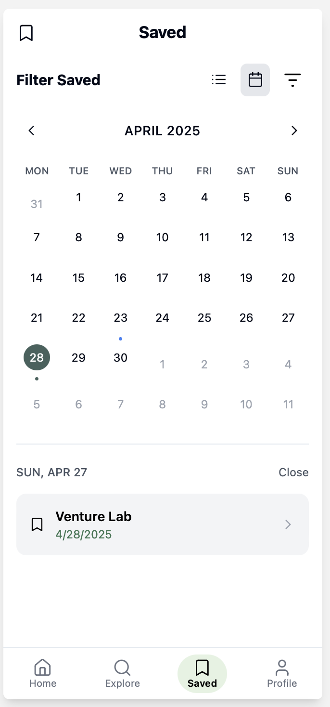
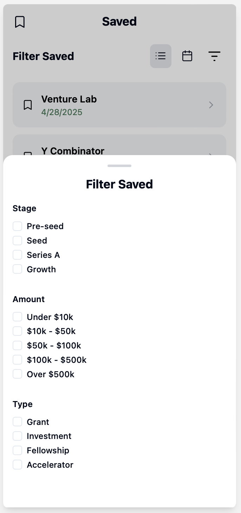

# Startup Grant Finder - Pomegrant



A mobile-first web application designed to help startups discover and apply for funding opportunities, grants, and accelerator programs. This project focuses on **intuitive UI/UX design** to make the funding discovery process seamless for entrepreneurs.

## Project Overview

This is a **UI/UX Design Project** created as a final project for a course focused on making user interfaces more intuitive and user-friendly. The application demonstrates modern mobile-first design principles with a focus on:

- **User Research**: Conducted interviews with potential users to understand their needs and pain points
- **Intuitive Navigation**: Designed with mobile-first approach for easy access on smartphones
- **Personalized Experience**: Tailored funding recommendations based on startup stage and industry
- **Streamlined Application Process**: Step-by-step guidance for grant and accelerator applications

> **Note**: This is a frontend prototype focusing on UI/UX design. Backend functionality is not implemented yet, as the primary goal was to create an intuitive user interface based on user research and feedback.

## Key Features

### Mobile-First Design
- Responsive design optimized for mobile devices
- Intuitive navigation with bottom tab bar
- Touch-friendly interface elements

### Smart Funding Discovery
- Browse grants, competitions, and investor opportunities
- Filter by startup stage, industry, and location
- Personalized recommendations based on user profile

### Application Support
- Step-by-step application checklists
- Interview preparation tips for different programs
- Decision timeline guidance
- Eligibility requirements for various programs

### Featured Programs
- **Y Combinator** - Application tips and eligibility
- **VentureLab** - Interview preparation and decision guidance
- **NSF SBIR Grants** - Government funding opportunities
- **Competition Programs** - Startup competition opportunities

## Technology Stack

- **Frontend**: React 18 with TypeScript
- **Styling**: Tailwind CSS with custom components
- **UI Components**: Radix UI primitives
- **Routing**: React Router DOM
- **State Management**: React Context API
- **Build Tool**: Vite
- **Icons**: Lucide React

## Application Screenshots

### Home Screen & Navigation


### Explore & Search Functionality


### Funding Opportunity Details


### Application Process


### Interview Tips & Guidance


### User Profile & Settings


### Saved Opportunities


### Filter & Search Features


## Getting Started

### Prerequisites
- Node.js (version 16 or higher)
- npm or yarn package manager

### Installation

1. **Clone the repository**
   ```bash
   git clone <repository-url>
   cd Startup-grant-finder-
   ```

2. **Install dependencies**
   ```bash
   npm install
   ```

3. **Start the development server**
   ```bash
   npm run dev
   ```

4. **Open your browser**
   Navigate to localhost to view the application

    `npm run dev` - Start development server

## Design Philosophy

This project emphasizes **user-centered design** principles:

1. **Mobile-First Approach**: Designed primarily for mobile users who are most likely to browse funding opportunities on-the-go
2. **Progressive Disclosure**: Information is revealed progressively to avoid overwhelming users
3. **Consistent Navigation**: Bottom navigation provides easy access to key features
4. **Visual Hierarchy**: Clear typography and spacing guide users through the interface
5. **Feedback & Guidance**: Toast notifications and tooltips provide helpful feedback

## User Research Insights

The design is based on interviews with:
- Early-stage startup founders
- Entrepreneurs seeking funding
- Accelerator program participants
- Grant application specialists

Key findings that influenced the design:
- Users want quick access to relevant opportunities
- Application processes need clear step-by-step guidance
- Interview preparation is a major pain point
- Users need to save and track opportunities

## Future Enhancements

While this is primarily a UI/UX design project, potential future features include:
- Backend API integration for real funding data
- User authentication and profile management
- Real-time notifications for deadlines
- Integration with application tracking systems
- AI-powered opportunity matching

## Course Context

This project was developed as a **final project** for a course focused on **intuitive UI/UX design**. The emphasis was on:

- Understanding user needs through research
- Creating intuitive navigation patterns
- Designing for mobile-first experiences
- Implementing modern UI components
- Testing and iterating based on user feedback